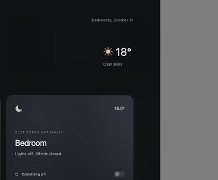

# Siri Island for Voice Satellite

A floating glass island with flowing, audio-reactive Siri-style waves for [Voice Satellite for Home Assistant](https://github.com/jxlarrea/voice-satellite-card-integration). It opens when Voice Satellite starts a voice interaction, changes with listening / thinking / speaking, and disappears when the interaction ends.

**The original animation is by [Neel Dedkawala](https://github.com/neeldedkawala).** This project adapts the shader and spring animation from his MIT-licensed **[iOS Siri Animation](https://github.com/neeldedkawala/ios-siri-animation)**. Please visit and credit the original project. The Home Assistant bridge, packaging, and audio-reactive adaptation are additions here.



[Full dashboard screenshot](docs/preview.png) · [Recorded preview](docs/preview.webm)

**Status: experimental 0.1.0.** Browser-tested in Chromium and WebKit with Voice Satellite's actual skin CSS and simulated activity/audio signals. Not yet tested against a running Home Assistant instance or physical Android/iPhone hardware. This is an independent community extension, not an official Voice Satellite or Apple product.

## What you install

This is a **companion JavaScript frontend resource**, enabled through Voice Satellite's Custom CSS field. Voice Satellite currently bundles its skins; it does not document a public API for registering third-party JavaScript skins. Consequently this extension does **not** add another item to its skin dropdown. Select the existing **Siri** skin and enable the island using the CSS below.

It uses the same activity-bar classes and `--vs-audio-level` value that Voice Satellite's bundled animated skins use. It does not open a microphone, run wake-word detection, connect to Home Assistant, or replace the Assist pipeline. Voice Satellite remains responsible for all of those functions.

- Morphs from a compact pill into the reference animation's rounded glass island.
- Reacts to local microphone and local speech playback levels when **Reactive activity bar** is enabled.
- Uses gentler procedural motion while thinking, or when real audio levels are unavailable.
- Stays attached to Voice Satellite's global UI across dashboard navigation.
- Pauses GPU rendering when idle or when the page is hidden; renders at up to 30 FPS with device pixel ratio capped at 2.
- Respects reduced-motion preferences and provides a static fallback if WebGL is unavailable or the context is lost.
- Makes no runtime network requests and loads no code from a CDN.

## Before installing

Install [Voice Satellite](https://github.com/jxlarrea/voice-satellite-card-integration) and configure a working Assist pipeline and a satellite on the browser/device you want to use. Confirm a normal voice interaction works first. Installing this skin alone does not enable voice control.

The adapter was developed against Voice Satellite commit [`78f0f4b`](https://github.com/jxlarrea/voice-satellite-card-integration/commit/78f0f4b74fec0d5be39de9089915dd1129991096). Its DOM selectors are internal compatibility points, not a guaranteed public API. Future upstream changes may require updating this extension.

## Install with HACS

This repository is designed for **HACS custom repository installation**, not yet included in the default HACS catalog.

1. Open **HACS → ⋮ → Custom repositories**.
2. Add `https://github.com/lukevink/siriAI-voicesatellite` with category **Dashboard**.
3. Download **Voice Satellite — Siri Island**.
4. Check **Settings → Dashboards → Resources** for a JavaScript module resource pointing to:

   ```text
   /hacsfiles/siriAI-voicesatellite/siri-island.js
   ```

   HACS may add this automatically. Add it only if it is missing. Advanced mode may be needed to see Resources.

5. In the **Voice Satellite** sidebar, open **Advanced**:
   - Skin: **Siri**
   - Reactive activity bar: **On**
   - Background Opacity: approximately **15–25%** if you want the dashboard visible behind the island.
6. Paste this into **Custom CSS**:

   ```css
   #voice-satellite-ui {
     --siri-island-enabled: 1;
     --siri-island-width: 240px;
     --siri-island-top: 20px;
     --siri-island-backdrop-blur: 2px;
   }
   ```

7. Save and reload the dashboard. Repeat the Voice Satellite appearance settings for each satellite/browser profile that should use the skin.

Dashboard resources load with dashboards. For loading from **every Home Assistant page**, including opening directly on a settings page, also register the same URL as an extra frontend module in `configuration.yaml`:

```yaml
frontend:
  extra_module_url:
    - /hacsfiles/siriAI-voicesatellite/siri-island.js
```

Merge this into an existing `frontend:` section rather than creating a duplicate key. Restart Home Assistant after changing YAML. The module is a singleton, so loading it through both routes does not create duplicate islands. See [Home Assistant's extra module documentation](https://www.home-assistant.io/integrations/frontend/#loading-extra-javascript).

## Manual installation

1. Copy [`dist/siri-island.js`](dist/siri-island.js) to `/config/www/siri-island.js` on your Home Assistant server.
2. Add `/local/siri-island.js?v=0.1.0` as a JavaScript module under Dashboard Resources, or use that URL under `frontend.extra_module_url` above.
3. Follow steps 5–7 from the HACS instructions.

No Python component, card YAML, or access token is required. Keep the copyright/license banner in the distributed JavaScript file intact.

## Adjusting the appearance

Change `--siri-island-width` to resize the whole animation. `--siri-island-top` is the distance below the device's safe-area inset, so it accounts for notches. The default position is top center. The shader stays dark on light or dark dashboards, like the reference.

The shader refracts a small generated studio-light texture. It **does not refract the live dashboard HTML**. The original demo refracts its own wallpaper texture, which cannot simply be replaced by a live web page. The island geometry, multicolor waves, and spring motion come from the original effect; the environment texture, cropping, audio modulation, and lifecycle are adapted.

When TTS is played on a remote speaker, Voice Satellite does not expose that speaker's audio levels to this browser. The skin still animates, but its movement is procedural rather than synchronized with remote audio. A wake chime or delay can also use an upstream synthetic level; the extension displays the signal it receives.

An iPhone can display the skin while the dashboard is active. The skin does not circumvent iOS background microphone restrictions or add screen-off wake-word detection.

## Disable or uninstall

Remove `--siri-island-enabled: 1` from Custom CSS (or set it to `0`). The extension removes its canvas and restores the original skin's activity bar. To uninstall completely, remove its dashboard/frontend resource and delete the HACS download or manual JavaScript file, then reload.

## Development and preview

```sh
npm ci
npm run build
npm run preview
```

Open `http://127.0.0.1:4173`. The preview has simulated listening, thinking, speaking, audio level, and skin controls; it does not connect to your home or record audio. Dashboard content in the preview is illustrative.

```sh
npx playwright install chromium webkit
npm run check
```

The browser tests exercise WebGL shader compilation, state changes, teardown/re-enable, UI replacement, duplicate loading, fallback, context loss, visibility transitions, and reduced motion. The test fixture is Voice Satellite's real Siri stylesheet at the pinned commit. Passing these tests does not establish end-to-end compatibility with every Home Assistant installation.

### Contributing it as a built-in skin

[`upstream/`](upstream/README.md) includes an adapter that adds **Siri Island** as a selectable built-in skin in a source checkout of Voice Satellite. It shares this project's renderer. That route requires rebuilding Voice Satellite and is intended for an upstream contribution or a maintained fork. It has not been accepted by the upstream project.

## Credits and licenses

- **Original animation, shader, and spring model:** [Neel Dedkawala — ios-siri-animation](https://github.com/neeldedkawala/ios-siri-animation), copyright © 2026 Neel Dedkawala, **MIT**. The original permission notice is preserved in [`licenses/ios-siri-animation.txt`](licenses/ios-siri-animation.txt), the built JavaScript, and the generated upstream runtime.
- **Voice engine, overlay conventions, and test stylesheet:** [jxlarrea — Voice Satellite](https://github.com/jxlarrea/voice-satellite-card-integration), **AGPL-3.0**. This extension relies on that project's work and keeps its attribution.
- **This repository:** **AGPL-3.0-only**, with the original shader retaining its MIT notice. See [`LICENSE`](LICENSE) and [`THIRD_PARTY_NOTICES.md`](THIRD_PARTY_NOTICES.md).

Siri and the original interface design belong to Apple. This is an independent visual adaptation and is not affiliated with or endorsed by Apple, Neel Dedkawala, Home Assistant, or the Voice Satellite maintainers.
