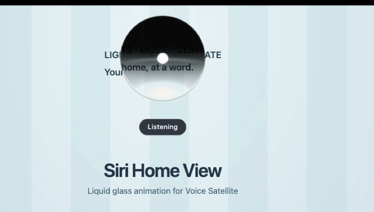
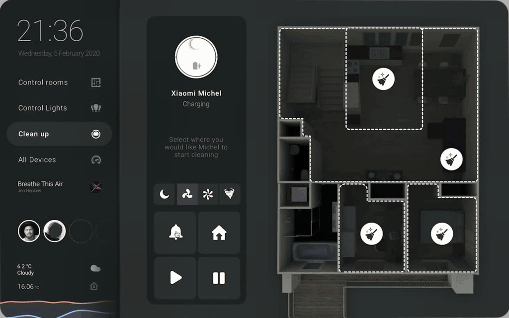

# Siri AI Home View Animation for Voice Satellite

A liquid drop from the top bezel that settles into a transparent glass orb or rounded island, with audio-reactive Siri-style waves for [Voice Satellite for Home Assistant](https://github.com/jxlarrea/voice-satellite-card-integration). It opens when Voice Satellite starts a voice interaction, changes with listening / thinking / speaking, and flows back into the bezel when the interaction ends.

Based on **[Neel Dedkawala’s iOS Siri Animation](https://github.com/neeldedkawala/ios-siri-animation)**, licensed under MIT.



Select Voice Satellite’s existing **Siri** skin and enable this animation with the Custom CSS below. It does not add a separate option to the skin dropdown.

## Before installing

Install [Voice Satellite](https://github.com/jxlarrea/voice-satellite-card-integration) and configure a working Assist pipeline and a satellite on the browser/device you want to use. Confirm a normal voice interaction works first. Installing this skin alone does not enable voice control.

## Install with HACS

This repository is designed for **HACS custom repository installation**, not yet included in the default HACS catalog.

1. Open **HACS → ⋮ → Custom repositories**.
2. Add `https://github.com/lukevink/siri-homeview-hass-animation` with category **Dashboard**.
3. Download **Siri AI Home View Animation for Voice Satellite**.
4. Check **Settings → Dashboards → Resources** for a JavaScript module resource pointing to:

   ```text
   /hacsfiles/siri-homeview-hass-animation/siri-island.js
   ```

   HACS may add this automatically. Add it only if it is missing. Advanced mode may be needed to see Resources.

5. In the **Voice Satellite** sidebar, open **Advanced**:
   - Skin: **Siri**
   - Reactive activity bar: **On**
   - Background Opacity: approximately **15–25%** if you want the dashboard visible behind the island.
6. Paste this into **Custom CSS**:

   ```css
   #voice-satellite-ui {
     --siri-island-enabled: 1;
     --siri-island-shape: circle;
     --siri-island-glass-opacity: 0.14;
     --siri-island-bottom-glow: 0.8;
     --siri-island-width: 240px;
     --siri-island-top: calc(var(--siri-island-width, 240px) * 0.096);
     --siri-island-backdrop-blur: 2px;
   }
   ```

7. Save and reload the dashboard. Repeat the Voice Satellite appearance settings for each satellite/browser profile that should use the skin.

Dashboard resources load with dashboards. For loading from **every Home Assistant page**, including opening directly on a settings page, also register the same URL as an extra frontend module in `configuration.yaml`:

```yaml
frontend:
  extra_module_url:
    - /hacsfiles/siri-homeview-hass-animation/siri-island.js
```

Merge this into an existing `frontend:` section rather than creating a duplicate key. Restart Home Assistant after changing YAML. See [Home Assistant's extra module documentation](https://www.home-assistant.io/integrations/frontend/#loading-extra-javascript).

## Manual installation

1. Copy [`dist/siri-island.js`](dist/siri-island.js) to `/config/www/siri-island.js` on your Home Assistant server.
2. Add `/local/siri-island.js?v=0.2.4` as a JavaScript module under Dashboard Resources, or use that URL under `frontend.extra_module_url` above.
3. Follow steps 5–7 from the HACS instructions.

No Python component, card YAML, or access token is required. Keep the copyright/license banner in the distributed JavaScript file intact.

## Adjusting the appearance

| Setting | Default | Effect |
| --- | --- | --- |
| `--siri-island-shape` | `circle` | `circle` selects the spherical orb; `island` retains the rounded shape. |
| `--siri-island-width` | `240px` | Width of the animation canvas; the visible orb occupies approximately 60% of it. |
| `--siri-island-left` | `50%` | Horizontal center of the orb and bezel bulge. Use a percentage or pixel value. |
| `--siri-island-bulge-width` | `1` | Bezel bulge width multiplier, from `0` to `1.4`. |
| `--siri-island-bulge-stretch` | `1` | Downward bezel bulge stretch multiplier, from `0` to `2.5`. |
| `--siri-island-top` | Proportional | Gap below the safe-area inset after the drop settles; defaults to approximately 16% of the circular orb diameter. Set a pixel value to override. The entrance always starts at the viewport top. |
| `--siri-island-glass-opacity` | `0.14` | Lower glass opacity from `0` to `1`; the upper cap stays dark. |
| `--siri-island-bottom-glow` | `0.8` | White lower glow strength from `0` to `2`. |
| `--siri-island-refraction` | `64` | Live backdrop displacement strength from `0` to `120` pixels; `0` disables it. |
| `--siri-island-entrance` | `drop` | Set `none` to disable the liquid entrance and return. Reduced-motion users also skip it. |
| `--siri-island-backdrop-blur` | `2px` | Blur applied to Voice Satellite's full-screen backdrop. |

Status labels (Listening, Thinking, Speaking) are hidden by default. Add the class `siri-island-show-status` to `#voice-satellite-ui` to display them. This does not affect conversation captions.



## Updating

Update through HACS, then reload the dashboard. If the repository folder changes, update the URL in Dashboard Resources and `frontend.extra_module_url` to the path provided by HACS. Remove obsolete resource entries so only the current skin loads. Restart Home Assistant after changing `configuration.yaml`.

## Disable or uninstall

Remove `--siri-island-enabled: 1` from Custom CSS (or set it to `0`). To uninstall completely, remove its dashboard/frontend resource and delete the HACS download or manual JavaScript file, then reload.

## Credits and licenses

- **Original animation:** [Neel Dedkawala — ios-siri-animation](https://github.com/neeldedkawala/ios-siri-animation), copyright © 2026 Neel Dedkawala, **MIT**. See [`original license`](licenses/ios-siri-animation.txt).
- **Thinking-dots visual inspiration:** [40973894 — Siri Wave / Fluid Dots](https://21st.dev/@40973894/components/siri-wave/fluid-dots).
- **Voice Satellite:** [jxlarrea — Voice Satellite](https://github.com/jxlarrea/voice-satellite-card-integration), **AGPL-3.0**.
- **This repository:** **AGPL-3.0-only**, with the original shader retaining its MIT notice. See [`LICENSE`](LICENSE) and [`THIRD_PARTY_NOTICES.md`](THIRD_PARTY_NOTICES.md).

Siri and the original interface design belong to Apple. This is an independent visual adaptation and is not affiliated with or endorsed by Apple, Neel Dedkawala, Home Assistant, or the Voice Satellite maintainers.
